# خيرات · Khairat

متجر إلكتروني للمنتجات الخليجية المحلية (عطور وعود، عبايات، تمور وقهوة) مبني بـ Flutter، عربي أولاً مع دعم كامل للإنجليزية، وفيه لوحة تحكم للتاجر.

An Arabic-first Flutter storefront for Gulf local products (perfumes & oud, abayas, dates & coffee) with a full merchant dashboard. All data is mocked and stored on the device, so the demo runs with no backend.

**Live demo:** _coming soon (GitHub Pages)_

<p>
  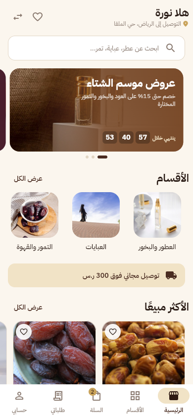
  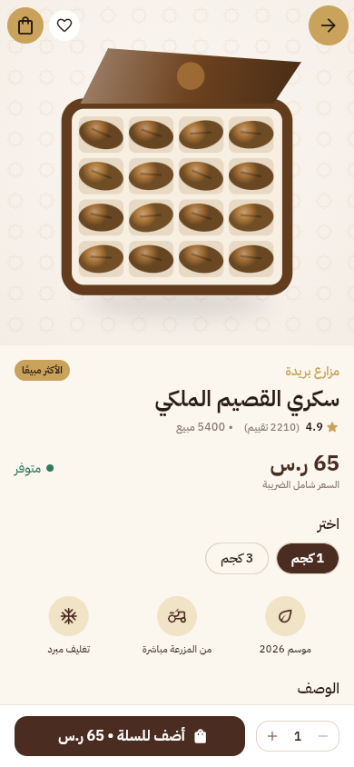
  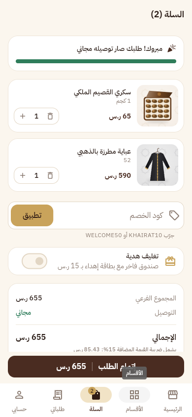
  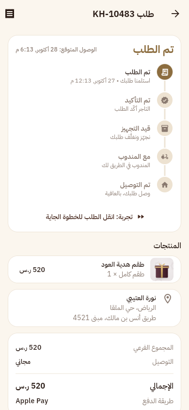
</p>

## المميزات · Features

**العميل · Customer**
- Home with offer carousel and countdown, category rails, skeleton loading
- Categories with brand chips, sort and price/rating filters, search with recent searches, favorites
- Product page with hero transition, variants (size, color, weight), reviews and similar products
- Animated add-to-cart (the item flies into the cart icon)
- Cart with free-shipping progress, coupons (`KHAIRAT10`, `WELCOME50`), gift wrap and gift message
- 3-step checkout: address on a map, delivery slot, payment
- Mocked payments: **Mada** (card BIN detection), **Apple Pay**, STC Pay (OTP), Tabby (4 installments), cash on delivery
- Order tracking timeline, cancel, reorder, rating, and a ZATCA-style VAT invoice with QR code
- Saudi (SAR, 15% VAT) and UAE (AED, 5% VAT) regions
- Arabic / English, RTL / LTR, light / dark

**التاجر · Merchant**
- Dashboard with KPIs, a 7-day sales chart, low-stock alert, top products
- Orders by status, moving an order through placed → confirmed → preparing → shipped → delivered
- Product management: price, stock, visibility
- Coupon creation and toggling

## التقنيات · Stack

Flutter 3.47 · Riverpod 3 · go_router · flutter_animate · fl_chart · qr_flutter · intl / gen-l10n · shared_preferences · IBM Plex Sans Arabic

## الهيكل · Structure

```
lib/
  core/       theme tokens, formatting, desktop phone frame
  data/       models, seed data, pricing & VAT rules, local repository
  state/      Riverpod providers (catalog, cart, checkout, orders, settings)
  features/   welcome, home, catalog, product, cart, checkout, orders, account, merchant
  widgets/    shared UI (product card, vector product art, shells)
  l10n/       Arabic and English strings
test/         pricing, VAT, coupon and order-flow tests
```

## التشغيل · Run

```bash
flutter pub get
flutter run                 # mobile or desktop
flutter run -d chrome       # web
flutter test
```

On wide screens the web build shows the app inside a phone frame with a side panel. Add `?embed=1` to the URL to show the app alone (used for embedding in the portfolio site), and `?lang=en` or `?lang=ar` to pick the starting language.

## لقطات · Screenshots

| | | | |
|---|---|---|---|
|  | 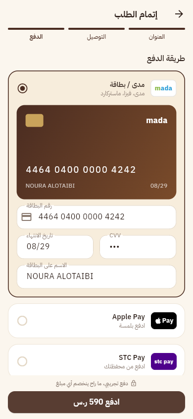 | 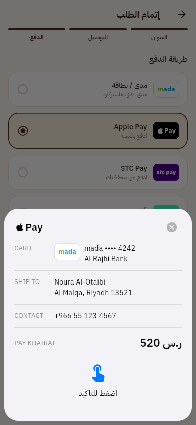 | 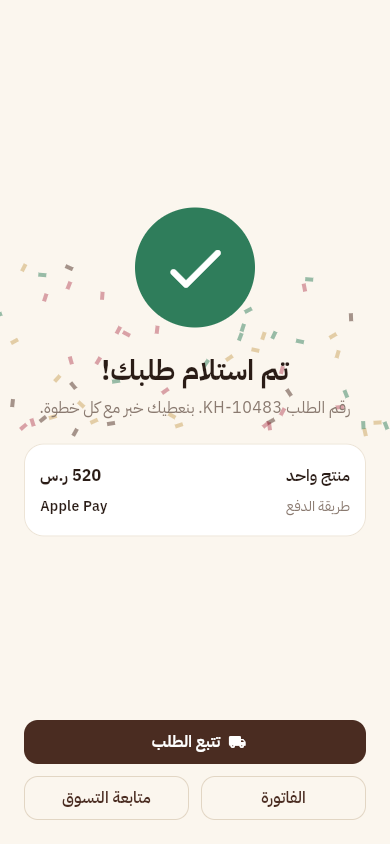 |
| 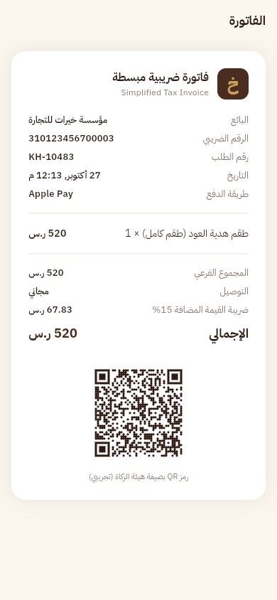 | 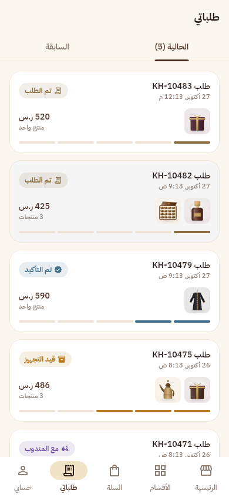 | 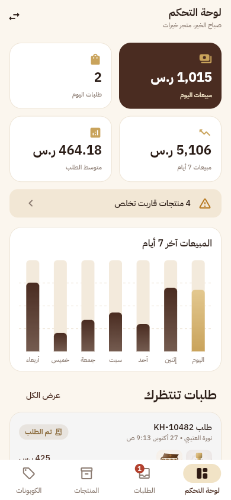 | 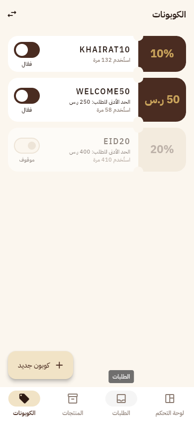 |
| 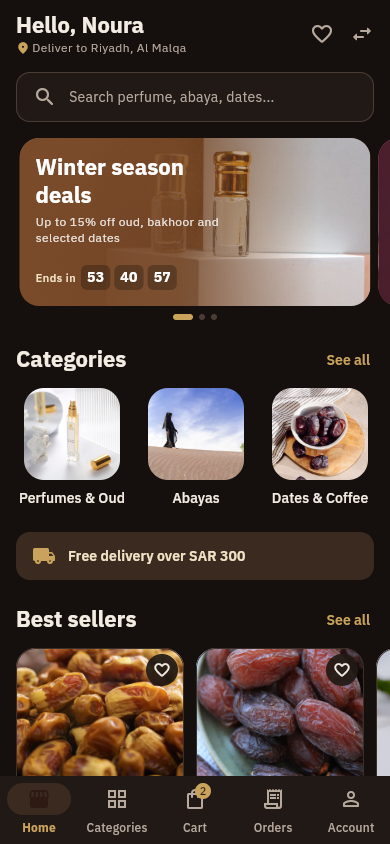 | 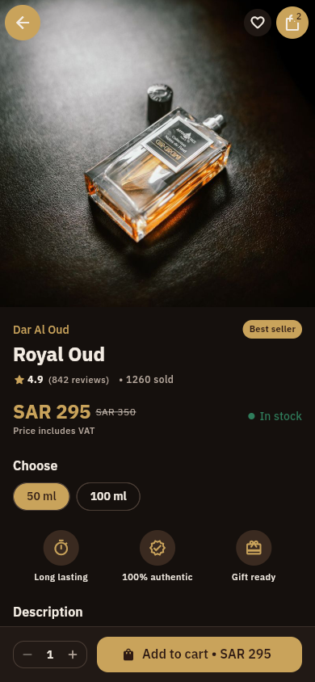 | 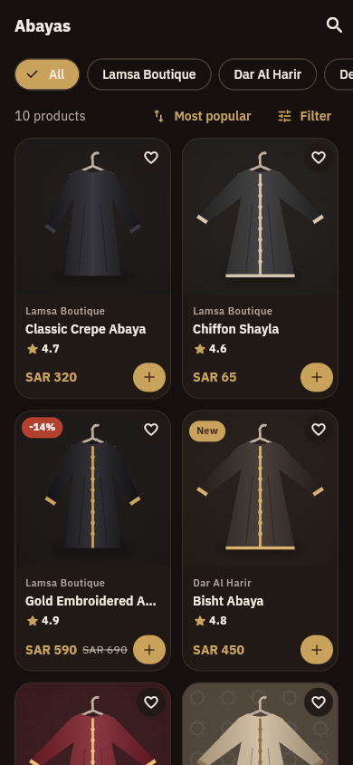 | 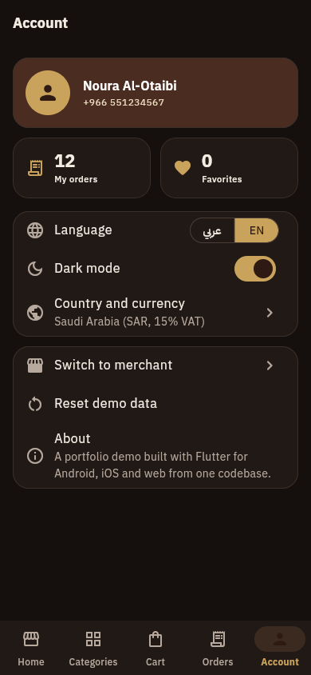 |

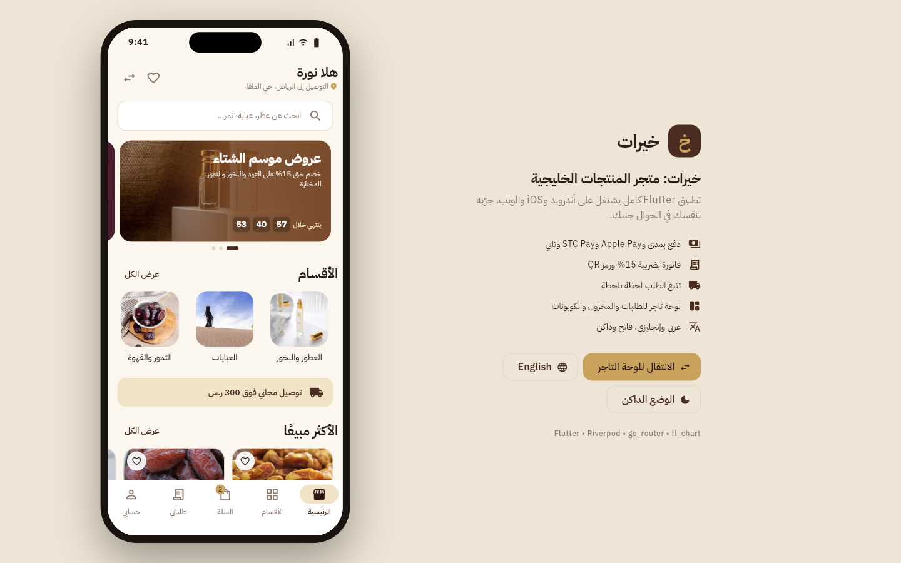
